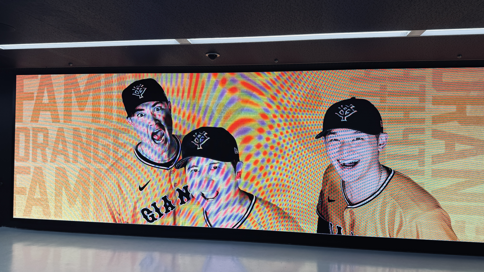
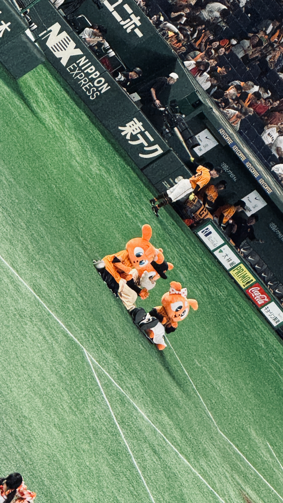
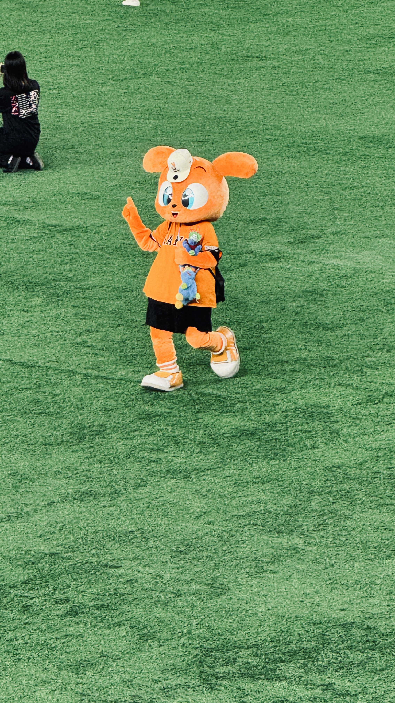
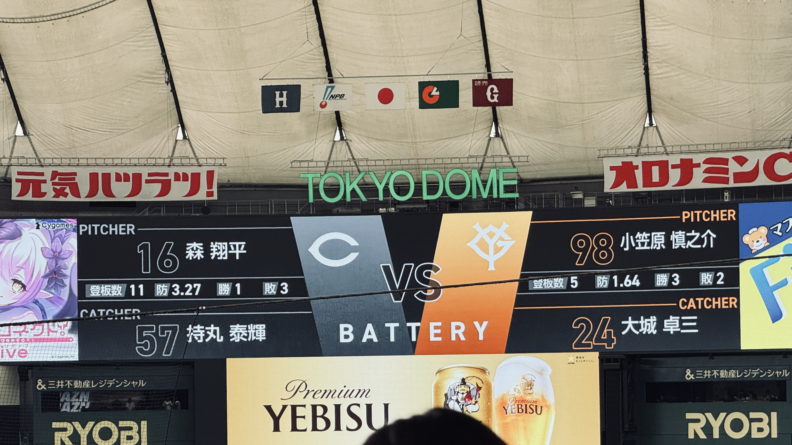
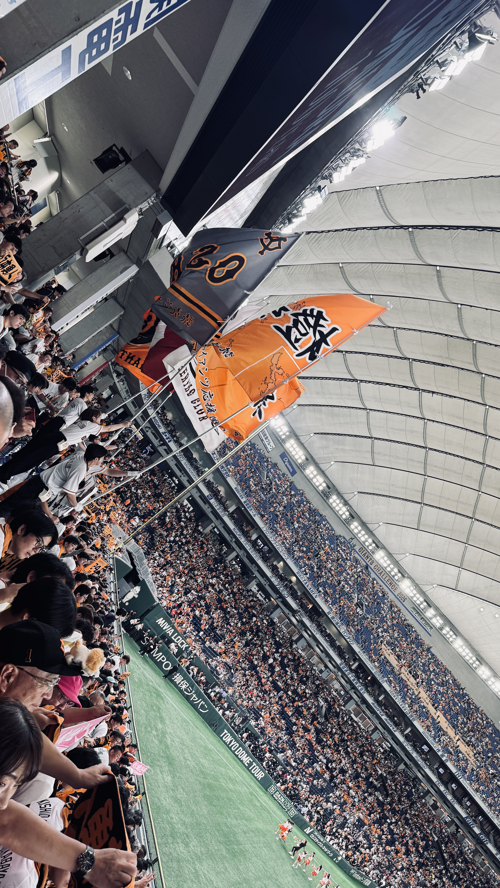

# 8月ラストの観戦！橙魂シリーズ！！

8月最後の現地観戦は、橙魂シリーズの東京ドームへ  
オレンジ一色に染まった選手たちを見ると、いつものドームとはまた少し違う熱気を感じます  

<!--more-->

*橙魂シリーズ1*

*橙魂シリーズ2*

*橙魂シリーズ3*

# 小笠原

*先発は小笠原*

先発は小笠原  
橙魂ユニフォームでの一戦、序盤からしっかり声を出して後押しします  

# 勝敗

*応援団*

結果は2-3で負けました  
チャンステーマを何回もやって、スタンドのボルテージも上がるのですが、肝心のところであと一本が出ない  
何度も「ここで決めてくれ！」と思わせてくれただけに、余計に悔しい試合でした  

打線はつながりそうでつながらず、最後まで重たい空気を振り払えないまま  
こういう日もあるとはいえ、現地で見ていると弱い打線の日だったなあと思ってしまいます  
ますりくと、勇人のホームラン出ただけに、無念...  

# 神宮から、決戦の甲子園へ

8月の現地観戦はこれでひと区切り  

次は神宮、そして決戦の甲子園へ  
首位とはもう3.5ゲームと広がってしまいました  

ここからの一戦一戦を、なんとか勝ちにつなげてほしいです

